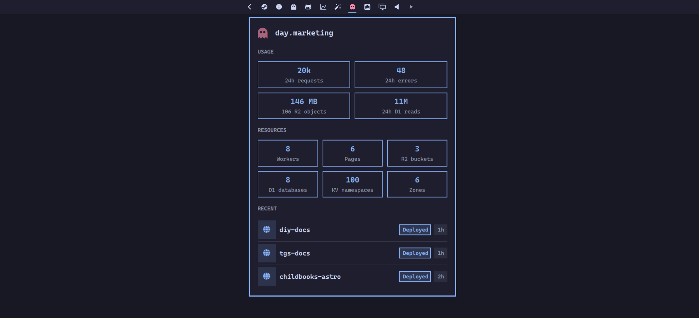

# Cloudflare



Bar widget for Cloudflare account resources, usage meters, and recent deploys. The panel opens with the zones list showing in a detail pane to its right. Clicking a tile, the zone count, or a row switches what that pane shows: a tile lists every resource of that type, busiest first, with its numbers and up/down status as pills, and a resource shows its live host, traffic, last deploy, and other details. A zone also shows its security settings (SSL mode, minimum TLS, Always HTTPS, HSTS, DNSSEC, SPF, DMARC) and an uptime check for each of its hostnames. Proxied hosts are checked automatically; DNS-only hosts, often mail or verification records, are checked when clicked. The refresh button re-checks everything. Esc steps back from a resource to its list, then closes the pane, then closes the panel.

This module ships with evoshell. The plugin id is `evo.cloudflare`.

## Requirements

- `curl` and `bash` on `PATH`
- `pass` for API token storage (optional if you only use the bar after manual setup)

## Auth

The bar loads a Cloudflare API token from:

```bash
pass insert evoshell/cloudflare/read-all
```

Use a token with read access to Workers, Pages, R2, D1, Queues, KV, and Zones. Cache purge actions need the Cache Purge permission on the relevant zone.

## Settings

Widget options live on the bar layout entry in `shell.json`:

```json
{
  "id": "evo.cloudflare",
  "refreshIntervalSec": 60,
  "analyticsIntervalSec": 900,
  "deployRows": 8,
  "overviewDeployRows": 3,
  "errorRatePercent": 1,
  "workerRequestsPerDay": 0,
  "r2StorageGb": 0,
  "d1RowsReadPerDay": 0,
  "projectsRoot": ""
}
```

Set usage limits above zero to show Workers requests, R2 storage, and D1 rows read as meters. `projectsRoot` overrides the default scan of `~/projects`, `~/src`, `~/dev`, and `~/code` for local Wrangler project paths.

## IPC

```bash
evo ipc shell toggle evo.cloudflare
evo ipc evo.cloudflare refresh
```

Removing the module does not delete:

- `pass` entry `evoshell/cloudflare/read-all`

Network: https://api.cloudflare.com, plus one HTTPS request to each hostname shown in the uptime checks.
